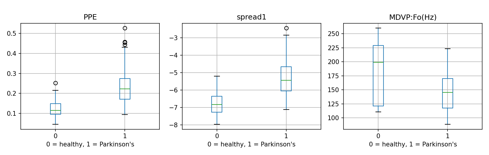

# Parkinson's disease from the voice, and AI clinical trial matching

**Part A:** can 22 voice measurements tell people with Parkinson's from healthy people?
**Part B:** can text embeddings and a language model match a patient description to recruiting Parkinson's trials and explain the fit?

**Status:** Stage 1 complete (data profiled, leakage experiment run). Part A modelling is next; Part B fetch script written, not run.

> Research project only. Not a diagnostic tool. Only public research data and fictional patient descriptions are used.

## Key finding so far: the split decides the score
Each person gave 6 to 7 recordings. Splitting the data by recording lets the model recognise the person's voice instead of the disease.

| Model | AUC, split by recording (leaky) | AUC, split by person (honest) |
|---|---|---|
| Always predict Parkinson's | 0.50 | 0.50 |
| Logistic regression | 0.91 | 0.77 |
| Random forest | 0.96 | 0.78 |

Honest balanced accuracy is about 0.64: a real signal, far from a dependable test. Reproduce with `src/01b_baselines_parkinsons.py`.



## Data
- Oxford Parkinson's Disease Detection dataset (Little et al., 2007), UCI ML Repository, CC BY 4.0: 195 recordings, 32 subject IDs (documentation says 31 people: open question). Included in `data/raw/`.
- Parkinson's Telemonitoring dataset (Tsanas et al., 2010), same source: 5,875 recordings, 42 people, symptom scores. Included in `data/raw/telemonitoring/`.
- ClinicalTrials.gov API v2 (Part B): fetched by `src/02_fetch_trials.py`.

See `DATA_SOURCES.md`.

## Plan
| Stage | Work | Status |
|---|---|---|
| 1 | Profile data; leakage experiment | Done |
| 2 | Person-level cross-validation, feature reduction, screening threshold, logistic regression rebuilt in PyTorch | Next |
| 3 | Symptom severity (UPDRS) on telemonitoring data | |
| 4 | Trial matcher: fetch trials, embeddings, top-5 retrieval, LLM explanation | |
| 5 | Evaluate on 20 fictional patients; ethics write-up | |

## Structure
```
src/01_load_and_profile.py      who is in the data, imbalance, correlations
src/01b_baselines_parkinsons.py leakage experiment
src/02_fetch_trials.py          recruiting Parkinson's trials from ClinicalTrials.gov
reports/                        profile, figures
docs/                           project brief (Word)
```

## Run
Python 3.10+, `pip install -r requirements.txt`, then run the scripts in `src/` in order.

## Author
Kerem Aviskan, BSc Economics, University of Warwick. Built with AI assistance, declared in my coursework.
